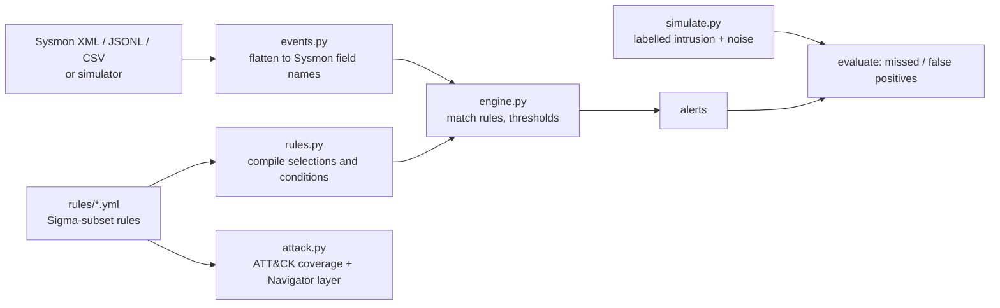

# AD & Sysmon Detection Lab

A home lab for Windows detection engineering, plus a Python detection engine that runs Sigma-style rules over Sysmon and Windows Security events and measures how good the rules are.

This is a learning and portfolio project, built with AI assistance. `data/sample_*` and the simulator are synthetic. `data/real/` holds real attack-emulation telemetry from the public OTRF Security-Datasets project (MIT licence), recorded in OTRF's lab. No employer, bank or customer data is used, and this repo is not production SOC experience. Lab scripts are for an isolated lab only.

## What is in here
| Part | What it does |
|------|--------------|
| `sysmonlab/` | Rule engine: Sigma-subset parser, condition language, threshold aggregation, XML/JSONL/CSV loaders, ATT&CK coverage, simulator and evaluator. Python 3.10+, one dependency (PyYAML). |
| `rules/` | 23 detection rules covering execution, persistence, credential access, lateral movement, discovery, defense evasion and impact. Each is tagged with ATT&CK ids. |
| `tests/` | 21 unit tests: modifiers, conditions, thresholds, XML parsing, and a ground-truth check of every shipped rule. |
| `scripts/`, `config/` | PowerShell to build the AD lab (`lab.local`), turn on auditing, install Sysmon with a compact config. |
| `docs/` | Detection map, rule-writing guide, generated ATT&CK coverage and a Navigator layer. |

## Quick start
```bash
pip install -r requirements.txt
python -m sysmonlab validate                    # compile all rules
python -m sysmonlab evaluate                    # score rules against the labelled simulation
python -m sysmonlab detect data/sample_sysmon.xml
python -m sysmonlab detect data/sample_events.jsonl --json
python -m sysmonlab coverage                    # ATT&CK table; add --layer out.json for Navigator
python -m unittest discover -s tests
```

`evaluate` generates benign noise plus a multi-stage intrusion (macro phishing, persistence, credential access, recon, lateral movement, impact), runs every rule and reports missed detections and false positives. It exits non-zero if either is found, and CI runs it on every push.

## Results on real telemetry
```bash
python tools/fetch_otrf.py     # optional: also fetches the two large datasets
python tools/eval_real.py
```
`tools/eval_real.py` runs every rule over the OTRF captures and compares with the attack that was emulated. The first run on real data found a real miss: a SYSTEM logon task that launched encoded PowerShell was not caught by `sl-0004`, which only looked at user-writable paths. It also found no rules at all for regsvr32 scriptlets, mshta and bitsadmin. Rules `sl-0020` to `sl-0023` were added for those. Sample output is in `docs/real-data-results.md`. Other hits on these files (for example event 1102 in a lab where the log was cleared between runs) are listed as extra hits, not hidden.

## How the engine works
1. Events from any source are flattened to Sysmon field names (`Image`, `CommandLine`, `TargetObject`, ...).
2. Each rule's selections compile to Python predicates; the `condition` string is parsed by a small recursive-descent parser.
3. `logsource.category` limits a rule to the matching Sysmon event ids so rules stay cheap.
4. `x-threshold` rules keep a sliding window per group key (e.g. source IP) and fire once when the count is reached.

See `docs/writing-rules.md` to add rules, and `docs/coverage.md` for what is covered today.

## Lab setup (Windows)
| Host | Role |
|------|------|
| DC01 | Domain Controller (Windows Server), domain `lab.local` |
| WS01 | Windows 10/11 workstation, domain joined, Sysmon installed |
| KALI | Attacker VM used to generate test activity (authorized lab only) |

1. Build two Windows VMs on an isolated host-only network.
2. On DC01 run `scripts/Build-LabDomain.ps1`, then `scripts/Enable-Auditing.ps1`.
3. On WS01 join the domain, run `Enable-Auditing.ps1` and `Install-Sysmon.ps1`.
4. Export events with `wevtutil qe Microsoft-Windows-Sysmon/Operational /f:xml > events.xml` and run `python -m sysmonlab detect events.xml`.

## Limitations
The condition language is a subset of Sigma (no aggregation conditions or `near`). Thresholds fire once per group and do not reset. Rules are starting points: tune them against your own environment before relying on them.

## Architecture


Detection rules with ATT&CK mapping: [docs/detection-map.md](docs/detection-map.md) and the generated [docs/coverage.md](docs/coverage.md).

## Scope and limits
**Tested**
- 21 unit tests (modifiers, conditions, thresholds, XML parsing, a ground-truth check of every shipped rule). `validate`, `evaluate` and the tests run in GitHub Actions on Python 3.11 and 3.12. I also ran the tests locally on Python 3.10.12 on 26 Nov 2026: all pass.
- Detection accuracy on the repo's own labelled simulation (which I also wrote) and on the public OTRF captures in `data/real/` (see `docs/real-data-results.md`).

**Not tested**
- any live Windows lab run end to end, the PowerShell lab scripts in `scripts/` (not executed in CI or locally), performance on large logs, Sigma features outside the supported subset, or any employer or production environment.

**Licence:** MIT, see `LICENSE`. Security reports: see `SECURITY.md`.
